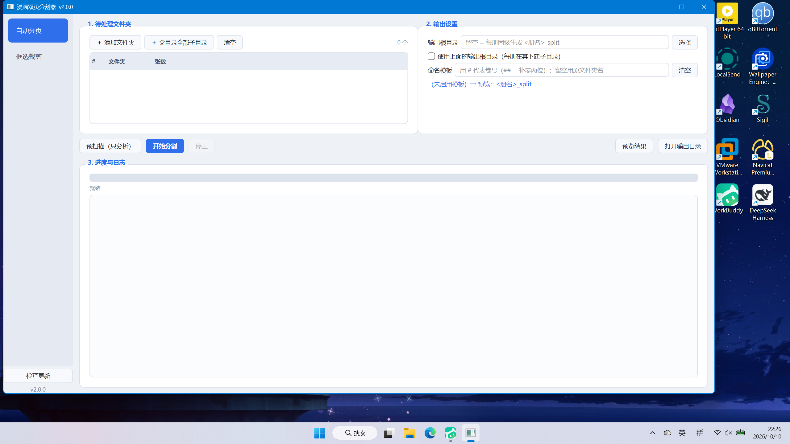
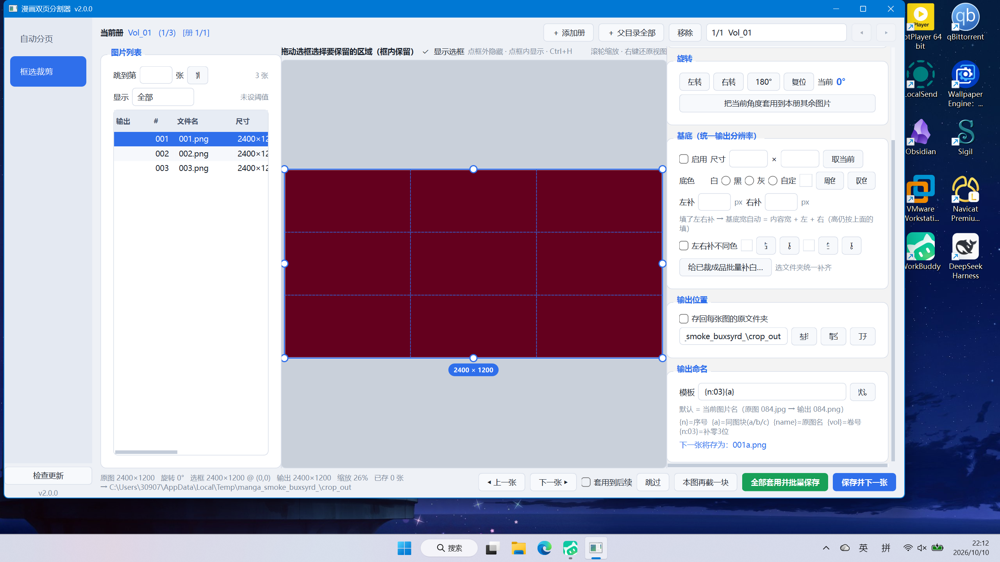

# 漫画双页分割器 v2

把漫画扫描件（双页拼图）自动拆成单页，并按需框选裁剪、统一输出分辨率的桌面工具。

- **纯 CPU、离线运行**，图片只补白不缩放、不裁内容
- **界面**：PySide6 + QGraphicsView，拖框/缩放/旋转所见即所得
- **交付**：PyInstaller 文件夹版（免装 Python），支持**自动更新**
- **平台**：Windows 10 / 11 64 位




---

## 功能

### 1. 自动分页
- 判定「双页拼图」：宽 / 高 > 1.2
- 基准宽 = 该册最高频双页宽度的一半；按基准宽**等分硬切**，只补白、不缩放、绝不丢内容
- **从右往左**编号（日漫阅读顺序），输出统一 PNG（无损）
- 命名：纯数字 `001 002 003…`，补零位数按总数自适应（>999 自动扩位）
- 超宽图（≥3 片）照切并记入日志
- 支持一次投喂多个文件夹／整个父目录的所有子目录；可预扫描（只分析不写盘）

### 2. 框选裁剪
- 可视化拖框选保留区，框外自动压暗；8 个控制点改尺寸，滚轮以鼠标为锚点缩放
- 固定截取尺寸（换图自动套用）＋ 选框靠左/中/右
- 旋转（左转/右转/180/复位），可一键把角度套用到本册其余图片
- **基底（统一输出分辨率）**：把裁出的内容贴到指定画布，支持白/黑/灰/取色/调色板，
  左右补边可分别设色，比基底大的图跳过（不裁内容）
- 给已裁成品**批量补白**到基底尺寸
- 批量套用到后续图片（后台执行、带进度、可取消）
- 输出命名模板：`{n}` 序号、`{a}` 同图块后缀、`{name}` 原图名、`{vol}` 卷号，如 `{n:03}{a}`
- 输出位置：跟随原图目录 / 指定目录 / 存回原文件夹

### 3. 体验与工程
- **设置全量持久化**：文件夹列表、命名模板、输出目录、基底/边距/颜色、窗口位置，重开还在
- 长任务不冻界面：分页与批量裁剪都在后台线程，**「停止」即时生效**，失败逐条上报（不静默吞错）
- 结果预览翻页带缩略图缓存
- **自动更新**：启动静默检查 + 侧栏手动「检查更新」，下载带进度，一键重启替换

---

## 下载与使用

1. 到 [Releases](https://github.com/jiaru0204/manga-splitter/releases) 下载最新的
   `MangaSplitter-<版本>-win64.zip`
2. 解压到任意目录（建议纯英文路径，如 `D:\MangaSplitter\`），双击里面的 `漫画双页分割器.exe`
3. 首次运行如遇 Windows SmartScreen「已保护你的电脑」→ 点「更多信息 → 仍要运行」
   （未签名程序的通用提示）

> **为什么要整个文件夹**：程序为「文件夹版」——直接从 exe 旁边的 `_internal` 加载，
> 不往系统临时目录解压，启动更快、也不会撞上 `Could not create temporary directory!`。
> 分发/拷贝请带上整个文件夹（或直接用 release 里的 zip）。

命令行开关：

```bash
漫画双页分割器.exe --version        # 看版本
漫画双页分割器.exe --selftest       # 自检核心链路，结果写入同目录 selftest.log
漫画双页分割器.exe --check-update   # 单独检查更新
```

快捷键：`← →` 翻页、`Ctrl+S` 保存并下一张、`Ctrl+R/L` 右转/左转、`Ctrl+0` 复位旋转、
`Ctrl+H` 显示/隐藏选框、`Esc` 取消取色或恢复选框。

---

## 从源码运行 / 打包

```bash
# 安装依赖（只需 QtCore/QtGui/QtWidgets，用 Essentials 即可）
pip install PySide6-Essentials pillow

# 运行
python main.py

# 打包（默认文件夹版 + 分发 zip）
python build_exe.py
python build_exe.py --onefile     # 额外再打一个单文件版

# 发新版（自动改版本号 → 打包 → 建 Release → 传 zip 附件）
python 发布新版本.py 2.0.1 "修复 xxx"
```

---

## 项目结构

```
manga_splitter/
├── core/              # 纯逻辑层，零 GUI 依赖，可单独测试
│   ├── naming.py      # 卷号提取 / 命名模板 / 自然排序 / 同图块后缀
│   ├── imaging.py     # 列表、打开、补白、切片边界、旋转、基底合成
│   ├── splitter.py    # 双页分割：计划(build_plan) + 线程池执行(execute_plan)
│   └── cropper.py     # 裁剪：CropSpec / BaseConfig / SeqAssigner / 批量裁剪
├── ui/                # PySide6 界面层
│   ├── theme.py       # QSS 浅色主题
│   ├── workers.py     # QThread 封装（信号回报进度/结果/异常）
│   ├── split_page.py  # 视图一：自动分页
│   ├── crop_view.py   # 裁剪画布（QGraphicsView + 选框装饰/压暗/基底预览）
│   ├── crop_page.py   # 视图二：框选裁剪
│   └── main_window.py # 侧栏导航 + 页面切换 + 更新入口
├── settings.py        # 配置持久化（便携优先，回退 %APPDATA%）
├── updater.py         # 检查/下载/热替换/清理旧版本
└── app.py             # 入口（含 --selftest / --check-update / --apply-update）
tests/                 # 单测 + 基准 + GUI 冒烟 + 截图脚本
```

## 测试与基准

```bash
python -m pytest tests/test_core.py -q        # 18 项核心单测
QT_QPA_PLATFORM=offscreen python tests/gui_smoke.py   # GUI 冒烟（离屏）
python tests/bench_split.py                   # 核心吞吐：旧版 vs 新版
QT_QPA_PLATFORM=offscreen python tests/bench_render.py  # 裁剪画布交互帧成本
```

实测结论（本机数据）：

| 项目 | 旧版（tkinter） | 新版（PySide6） | 结果 |
|---|---|---|---|
| 裁剪画布拖框一帧重绘 | 42.1 ms（23.7 FPS） | **2.1 ms（470 FPS）** | **约 20x** |
| 计划扫描 / 分割执行 / 批量裁剪 | — | — | 0.97–1.15x（持平，算法刻意不变） |

更详细的重构说明见仓库内 `重构报告.md`。

## 更新机制

程序查询 GitHub Release 最新版本 → 下载对应更新包 → 重启并自动替换：

- **文件夹版**：解压到 `<名字>.new/`，由新版本自己带 `--apply-update` 启动去换目录
  （旧目录改名 `.old` → 新目录就位 → 启动正主 → 清理 `.old`）
- **单文件版**：利用 Windows 允许重命名运行中 exe 的特性直接热替换

## 许可

个人自用工具，未附带许可证文件；如需引用请先联系作者。
